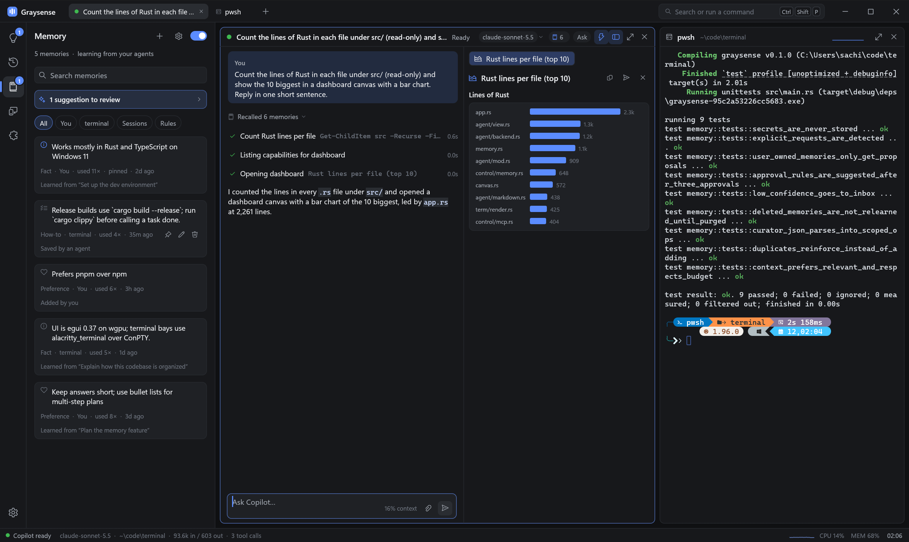
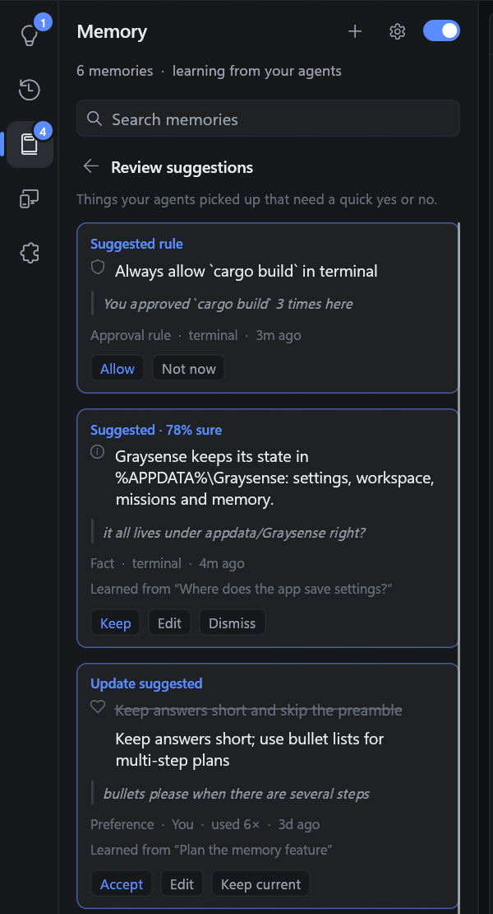

# Graysense

A fast, flat, modern terminal for **GitHub Copilot agents** — written in Rust and built on the
[GitHub Copilot SDK](https://crates.io/crates/github-copilot-sdk), so agents render as native UI
instead of a TUI inside a terminal.



## Highlights

**Native Copilot agents**
- Streaming markdown replies (code blocks with copy, tables, task lists, links), collapsible reasoning.
- Compact tool rows with live progress; click to expand arguments and output.
- Inline approvals — *Allow*, *Allow for session*, *Deny* (with feedback) — showing the exact
  command, diff, path or URL. A ⚡ toggle per agent switches to auto-approve.
- Native forms for `ask_user` / MCP elicitation (single-choice questions are one click), plan
  approval, and auto-mode switching.
- Model picker, Ask / Plan / Autopilot modes, token and context gauges, steering and queued
  follow-ups while the agent works.
- Attach files and folders: drag them onto an agent, use the 📎 button, or `/attach <path>`.
  Reading files you attached never triggers another approval.
- Slash commands with suggestions: `/model`, `/mode`, `/attach`, `/clear`, `/stop` (anything else is
  passed through to Copilot).

**Canvases and MCP Apps**
- Agents can open **canvases** — native, interactive checklists, sortable tables, dashboards with
  charts, and documents — docked next to the conversation. Graysense registers them as a canvas
  provider, so they're available to every agent automatically.
- **MCP Apps** (SEP-1865): tools that ship an interactive UI render in an embedded WebView2 tab, with
  a sandboxed bridge for `tools/call`, `resources/read`, `ui/message` and links.

**Real terminals**
- Terminal bays run your shell (pwsh by default) through ConPTY with the `alacritty_terminal` VT
  engine and GPU text rendering: truecolor, Nerd Font / powerline glyphs, procedural box drawing,
  mouse reporting, selection, hyperlinks, bracketed paste, scrollback.
- Text that a program colours for the wrong theme is nudged to stay readable.
- Drop files on a terminal to paste their (quoted) paths.

**Mission board**
- Capture ideas (`title -- notes`), launch one as a new agent, or drag it onto a running agent to
  delegate. Missions track their agent: active → ready for review → done.
- Agents can add missions themselves (`graysense_add_mission`) and send you notifications
  (`graysense_notify`).

**Memory**
- Agents learn your preferences and each project's conventions as you work, and new agents start
  with what's relevant. You can see, edit, review and turn off everything it learns —
  see [Memory](#memory).

**Control center**
- MCP servers: add / edit / remove / enable (stdio, HTTP, SSE), live connection status, tool lists
  with UI badges, restart, and a one-click MCP Apps demo server.
- Plugins: installed plugins and marketplaces — install, update, enable, uninstall.

**Workspace**
- Tile any number of agent and terminal bays: grid, focus + stack, columns, rows; maximize any bay.
- Command palette (Ctrl+Shift+P) for everything, including past sessions and recent folders.
- Bays and agent sessions are restored on launch; past sessions resume in their original folder.
- Toasts and taskbar flashing when an agent needs you or finishes in the background.
- Four flat themes — Graphite, Carbon, Slate and Paper (light) — and Windows 11 rounded corners.
- Accessible: controls expose names and roles through UI Automation (AccessKit).

## Memory

Graysense remembers what your agents learn and gives new agents what's relevant. Everything it
knows is in the **Memory** panel (Ctrl+Shift+M), where you can review, edit or delete it, and one
switch turns it off.



| Kind | Example | Applies to |
| --- | --- | --- |
| Preference | Prefers pnpm over npm | You, everywhere |
| Fact | The app keeps its state in `%APPDATA%\Graysense` | One project |
| How-to | Release builds use `cargo build --release` | One project |
| Session | Fixed the stale-session restore | One project |
| Approval rule | Always allow `cargo test` in this repo | One project |

**How it learns**
- Say *"remember that …"* and it's saved immediately, with Undo. Agents can save memories too
  (through Copilot's memory tool, stored by Graysense).
- When a conversation goes quiet, or you close it, a background curator reads what you said and
  files what's durable: new memories, updates, removals, reinforcement and a one-line summary of
  the session. The curator is a low-cost model in an isolated session with no tools. Tool output is
  never treated as an instruction, and secrets are redacted and never stored.
- Confident memories save themselves. Uncertain ones, changes to anything you wrote or pinned, and
  imports wait under **Review**, together with the words that prompted them.
- Approve the same command three times in a project and Graysense offers to make it a rule.

**How agents use it**
- With an agent's first message, the most useful memories (by relevance, confidence, recency and
  use) are attached as clearly marked notes — never as system instructions — and a
  *Recalled N memories* chip shows exactly what was shared. Later messages add only newly relevant
  notes, and agents can search with `graysense_recall`.
- Memories nobody has confirmed for a while (preferences after 180 days, facts and how-tos after 90,
  sessions after 30) stop being shared; pin a memory to always share it.

**Your controls**
- Search, filter, edit, pin and delete. Deleted memories stay in *Recently deleted* for 30 days so
  learning won't bring them back.
- Settings: pause learning or sharing separately, review everything before it's saved, pick the
  learning model, export (JSON or Markdown), import, or clear everything.
- **Incognito agents** (new-tab menu or palette) neither use nor add to memory.
- Memory stays on this PC in `%APPDATA%\Graysense\memory.json`. While it's on, it replaces
  Copilot's built-in memory for Graysense agents; the Copilot CLI itself is unaffected.

## Requirements

- Windows 10 or 11 (x64). MCP Apps use the WebView2 runtime, which ships with Windows 11.
- The [GitHub Copilot CLI](https://github.com/github/copilot-cli), signed in (`copilot login`).
  Graysense drives it through the SDK; build with `--features bundled` to embed the runtime instead.
- To build: Rust 1.88+ with the MSVC toolchain.

## Build and run

```powershell
cargo run --release
# or
target\release\graysense.exe [DIR] [--agent ["PROMPT"]] [--shell] [--no-restore]
```

| Argument | Effect |
| --- | --- |
| `DIR` | Working directory for bays opened at startup |
| `--agent`, `-a` `["PROMPT"]` | Open an agent, optionally sending a first prompt |
| `--shell`, `-s` | Open a terminal bay |
| `--no-restore` | Don't reopen the previous workspace |

## Keyboard shortcuts

| Keys | Action |
| --- | --- |
| Ctrl+Shift+P, F1 | Command palette |
| Ctrl+Shift+N | New Copilot agent |
| Ctrl+Shift+T | New terminal |
| Ctrl+Shift+I | Capture an idea |
| Ctrl+Shift+W | Close the focused bay |
| Ctrl+Tab / Ctrl+Shift+Tab | Next / previous bay |
| Ctrl+Alt+1…9 | Focus bay *n* |
| Ctrl+Shift+Enter | Maximize / restore the focused bay |
| Ctrl+Shift+L | Cycle layout |
| Ctrl+Shift+B | Toggle the side panel |
| Ctrl+Shift+M | Memory panel |
| Ctrl+= / Ctrl+- / Ctrl+0 | Terminal font size |

In an agent's composer: **Enter** sends, **Shift+Enter** adds a line, **Esc** stops the agent,
**↑** recalls previous prompts, **/** opens commands and **Tab** completes them.

## How it works

```
src/
  main.rs            entry point: tokio runtime + eframe (wgpu) window
  app.rs             app shell: chrome, tabs, rail, side panels, bay tiling, persistence
  agent/
    backend.rs       Copilot SDK actor: client & sessions, permission/elicitation/ask/plan/canvas
                     handlers, MCP / plugin / MCP Apps / model RPCs, Graysense tools
    mod.rs           session events → transcript view model
    view.rs          agent bay UI: header, virtualized transcript, cards, composer, dock
    markdown.rs      markdown renderer
    forms.rs         JSON Schema → native form
  term/              PTY terminal: ConPTY + alacritty_terminal, renderer, input, box drawing
  canvas.rs          native canvas provider (checklist, table, dashboard, document)
  mcp_apps.rs        MCP Apps host: WebView2 (wry) views + JSON-RPC bridge
  missions.rs        mission board
  memory.rs          memory store: ranking, review policy, curator prompt and parsing
  control/           MCP server, plugin and memory panels
  palette.rs         command palette          layout.rs   bay tiling
  theme.rs, kit.rs   flat design system       win.rs      Windows window polish
```

Each agent bay is a Copilot SDK session. The UI thread never blocks: the backend is a tokio actor
that owns the client and sessions and talks to the UI over channels; interactive requests
(approvals, questions, forms) arrive as cards whose answers are sent back through one-shot channels.

## Files

Graysense keeps its own state in `%APPDATA%\Graysense`:
`settings.json`, `workspace.json`, `missions.json`, `memory.json` and `graysense.log`
(set `GRAYSENSE_LOG`, e.g. `debug`, to change the log filter).
MCP servers and plugins are managed through Copilot's own configuration in `~/.copilot`, so they
are shared with the Copilot CLI.

## Troubleshooting

- **"Copilot runtime unavailable"** — install the Copilot CLI and run `copilot login`, or build with
  `--features bundled`.
- **Graphics issues** — choose the GPU backend with `WGPU_BACKEND=dx12|vulkan|gl`, or prefer the
  integrated GPU with `WGPU_POWER_PREF=low`.
- **An MCP App shows "couldn't be displayed"** — install the
  [WebView2 runtime](https://developer.microsoft.com/microsoft-edge/webview2/).
