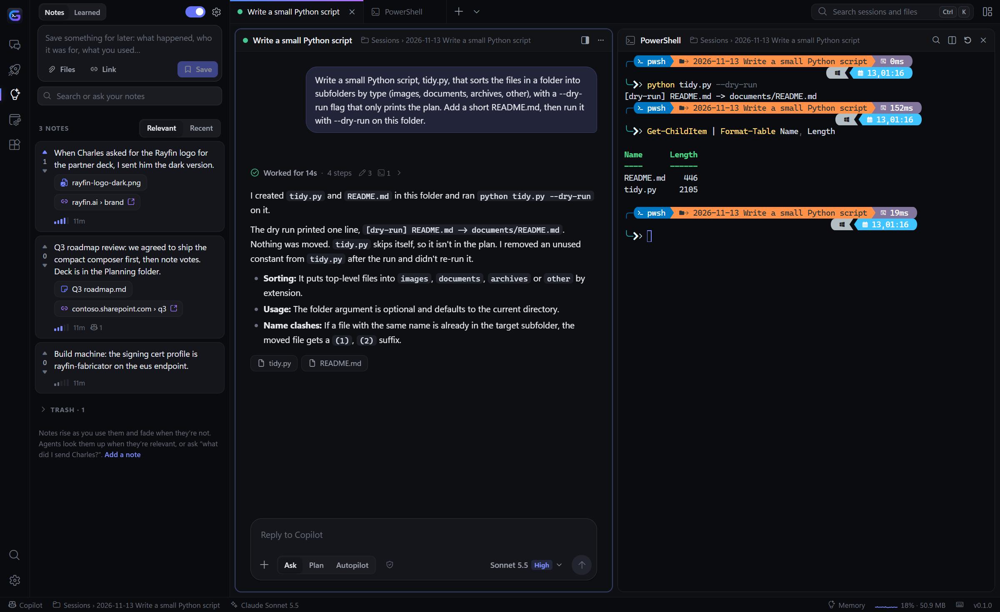

# Graysense

A futuristic workbench for **GitHub Copilot agents**: a Rust core on the
[GitHub Copilot SDK](https://crates.io/crates/github-copilot-sdk) with a fast, flat, modern
interface (Tauri + React). Run agents and terminals side by side, keep the context you'll need
later, and let Copilot set everything up for you.



## Install

Download **Graysense-win-Setup.exe** from the [latest release](https://github.com/spatney/graysense-terminal/releases/latest)
and run it. It installs for your account (no admin rights), adds a Start menu shortcut and opens.
The installer and app are code-signed. Installed copies update themselves: new versions download
in the background and install when you restart or close Graysense (the repository is private, so
updates sign in with your GitHub CLI login, `gh auth login`).

Needs Windows 10 or 11 (x64) and the [GitHub Copilot CLI](https://github.com/github/copilot-cli),
signed in (`copilot login`).

## Highlights

**Copilot agents, Claude-style**
- A centered conversation with streaming markdown answers (highlighted, copyable code; tables;
  task lists). While the agent works, a live **work log** shows every step — commands with their
  output, edits as diffs, reads, searches, web fetches, subagents — and folds into
  "Worked for 2m · 14 steps" when the turn is done.
- Inline cards for **approvals** (*Allow*, *Allow for session*, *Deny* with feedback, showing the
  exact command, diff, path or URL), **questions**, **forms** and **plan reviews**.
- **Settings > Agents > Approve all tool calls by default** lets new sessions run tools without
  asking, including commands and file changes. Off by default; existing and resumed sessions
  are unchanged. Each session still has its own approval toggle.
- **Ask / Plan / Autopilot** modes (Shift+Tab), a context meter, Esc to stop, ↑ for earlier
  messages, and slash commands (`/model`, `/effort`, `/context`, `/mode`, `/attach`, `/cd`,
  `/rename`, `/learn`, `/clear`, `/stop`, `/terminal`, `/new`).
- **Steer the agent while it works**: Enter sends a message that Copilot reads at its next step,
  without waiting for the turn to finish. Ctrl+Enter queues it for after the turn instead.
- **A model picker with thinking levels and context windows**: models grouped into Powerful,
  Versatile and Fast, with Auto at the top; how hard the model thinks (Auto, Low, Medium, High,
  Extra high, Max, as each model offers them); and, for models that have a long window, how much
  the session holds before compacting (Auto, the standard size such as 200K, or the long one
  such as 1M; the picker says when the long window costs more per token). Change them
  mid-session, or make them what new sessions start with (Settings > Agents has the defaults).
- Attach files by dropping them on an agent, with the + button, or `/attach <path>`.
  Type **@** in a message to autocomplete paths from the session folder (the default folder
  before a session has its own folder). Use Up/Down and Tab/Enter to select, navigate folders,
  or Esc to dismiss.
  Absolute paths, `..`, `~`, and quoted paths with spaces work too. Selected files are attached
  when you send; deleting a mention before sending removes it from the message's attachments.
  **Paste an image** (Ctrl+V a screenshot or a copied PNG, JPEG, GIF or WebP picture) into the
  message box to attach it to the next message; pasting on the home screen starts a session.
  Pasted images are kept in `%APPDATA%\Graysense\pasted-images`; ones older than 30 days are
  deleted the next time you paste.
  **Images preview** as thumbnails in the message box, in your messages and in the Files panel;
  click one to see it large, with buttons to open it, reveal it or copy its path.

**Notes: a bucket for context you'll need later**
- Save what happened — *"When Charles asked for the Rayfin logo, I sent him the dark version"* —
  with the files and links that go with it. Capture from anywhere with **Ctrl+Shift+S**, the
  bookmark on any message, or by dropping files on Memory › Notes. Graysense keeps a copy of each
  file, so the note still works if the original moves.
- **Search or ask**: type *"what did I give Charles?"* and Copilot answers from your notes, with
  their files attached. Notes also show up in Ctrl+K search, and agents look them up on their own
  when they're relevant (`graysense_recall`), or save one when you ask (`graysense_save_note`).
- **Relevance that maintains itself**: upvote or downvote any note; opening its files, copying it
  and agents using it raise it, and notes nobody touches fade (half-life of about four months).
  Rarely useful notes collect in one place to clean up in a click; deleted notes wait in the
  trash for 30 days.

**Memory you can see and control**
- Agents learn your preferences and each project's conventions in the background (a cheap model
  reads finished conversations); new agents start with what's relevant. Review suggestions,
  edit, pin or delete anything, see where each memory came from, export or import it, and turn
  learning — or all of memory — off. Incognito sessions never read or write memory.

**Sync to GitHub**
- Keep your **memories, notes (with their files), missions and a few preferences** in a **private
  GitHub repository**, so they survive a reinstall and follow you between PCs. **Settings > Sync**
  makes the repository for you (with the [GitHub CLI](https://cli.github.com): `gh auth login`) or
  connects one you already have. It needs Git installed.
- Connect a repository that already holds Graysense data (from another PC, say) while this PC has
  some too, and choose **Merge with AI**: duplicates are combined, conflicts are settled by rules
  (what you wrote wins, then the newer), and an AI pass compares what each PC learned on its own.
  Anything you wrote or pinned is only *proposed* for change, waiting in Memory › Review; notes are
  never rewritten; and a backup of this PC's memory is kept first
  (`%APPDATA%\Graysense\sync\backups`). Or take the repository's copy as it is.
- After that it syncs by itself: shortly after you change something, when Graysense opens, and every
  so often (or press **Sync now**). A deletion on one PC reaches the others, and a deleted memory can
  still be restored for 30 days. Project memories follow the project's git remote, so the same
  repository cloned into different folders shares its memories.
- A sync never passes on a wipe. If most of what was synced would go at once (the repository was
  deleted and made again, this PC's memory file wouldn't load, you pressed "forget everything"),
  Graysense stops and asks: put it back, or go ahead. Nothing has changed until you answer.
- The repository is yours to browse: `MEMORY.md` is a readable copy of everything. Never synced:
  approval rules (they let commands run without asking), folders, your shell and any setting that
  changes what agents may do on their own. A public repository is refused unless you confirm, and
  anything that looks like a secret stays on the PC it's on.
  What comes back from the repository is checked before it's used: file names, paths that lead off
  the PC, files a note names on another PC (never given to an agent), and settings outside the
  short list above are never trusted.

**Sessions**
- Every new session gets its own folder, named after your first message, in a sessions folder you
  choose (`~\Graysense\Sessions` by default). A history sidebar (Ctrl+Shift+H): open sessions,
  pinned, then Today / Yesterday / Previous 7 days…, with rename, pin, reveal and delete, plus an
  activity feed. Sessions started in the Copilot CLI are listed too.
- **Move a session to another folder** at any time: click the folder beside its title (or on its
  home screen) and choose **Change folder**, type `/cd <folder>` (`/cd` alone picks one), or use
  the command palette. The agent's commands, file lookups, permissions, project instructions and
  memory follow it there. A new session that hasn't started yet starts in the folder you choose
  instead of getting its own.
- **Pick up where you left off**: Graysense reopens the sessions and terminals you had open, with
  each session's name and approval choice. An agent that was working when Graysense closed (or
  restarted to update) carries on with its task, and messages it hadn't read yet are sent again.
- **Search everything** (Ctrl+K): notes, session names and conversations, and the contents of every
  file in your sessions folder, with highlighted snippets and line numbers.
- Each agent has a side panel with its **files** (open the folder in VS Code from there), the
  **changes** it made, and any canvases or apps.

**Bays and terminals**
- Tile agents and terminals in a grid, columns, rows or one at a time; drag tabs to reorder;
  maximize with Ctrl+Shift+Enter.
- **Recent folders** are a hover away: in the ⌄ menu beside +, **New agent in folder ›** and
  **New terminal in folder ›** list the folders you've worked in lately, with **Choose a folder…**
  for any other.
- Real terminals (PowerShell, Command Prompt, Git Bash or WSL) through ConPTY with xterm.js and
  WebGL: find, copy and paste, clickable links, and flow control so floods of output never freeze
  the app. Drop files on a terminal to type their paths.

**Mission board**
- Capture ideas (Ctrl+Shift+I), then launch one as a new session or drag its card onto an agent to
  delegate it. Missions follow their agent: in progress → ready for review → done. Agents can add
  missions too.

**Canvases, MCP Apps, MCP servers and plugins**
- Agents open native **canvases** next to the conversation: checklists you can tick, sortable
  tables, dashboards with charts, and documents.
- **MCP Apps** (SEP-1865) render in a sandboxed frame with their own content security policy.
- Manage **MCP servers** (local commands or remote URLs, status, tools, restart) and **plugins**
  (installed, marketplaces, browse and install).

**Ask agents to set things up**
- Everything you can configure, agents can configure for you: *"switch to the light theme"*,
  *"make new sessions go in D:\Work"*, *"add the GitHub MCP server"*. Appearance changes apply
  right away; anything else shows the exact change and asks first.

**Look and feel**
- Four themes — Graphite, Carbon, Slate and Paper (light) — with the native title bar painted to
  match, interface zoom (Ctrl+= / Ctrl+-), a command palette (Ctrl+Shift+P) and every shortcut on
  one sheet (Ctrl+/).

## How it's built

```
src-tauri/          Rust: the Graysense core
  src/agent/        Copilot SDK actor (sessions, tools, permissions, canvases, MCP, plugins)
  src/engine/       UI-agnostic core: bays, actions, learning, and dirty-tracked UI updates
  src/memory.rs     memory and notes (ranking, relevance, curation, attachments)
  src/sync/         GitHub sync: items and the three-way merge, git transport, AI reconcile
  src/terminal/     PTY service (ConPTY via portable-pty)
  src/search.rs     search index over sessions and session files
  src/update.rs     Velopack updater (draft-aware GitHub releases source)
src/                React + TypeScript UI (Vite)
  components/       shell, agent bay (transcript, composer, prompts, dock), terminal, panels
  lib/              store (applies core updates), API, notes ranking, theming
scripts/            release.ps1 (build, sign, package, publish), render-assets.ps1 (icons)
.github/workflows/  ci.yml (tests), release.yml (the release, from a version tag)
```

The core runs on its own thread: backend events in, batched UI updates out (only what changed;
transcripts as per-item patches). The UI calls one `act` command with typed actions.

## Develop

Needs Node.js 20+, Rust 1.94+ and the Copilot CLI.

```powershell
npm install
npm run tauri dev           # Vite dev server + the debug app with hot reload
npm test                    # frontend tests (vitest)
npm run typecheck
cd src-tauri; cargo test    # core tests
```

`GRAYSENSE_CONFIG_DIR` points the app at another profile (settings, memory, workspace), handy for
trying things without touching your own. `GRAYSENSE_LOG=debug` turns up logging
(`%APPDATA%\Graysense\graysense.log`). `GRAYSENSE_SYNC_REMOTE` points sync at a folder of bare
repositories (`<owner>/<name>.git`) instead of github.com, to try sync (two profiles, one repository)
without GitHub.

## Release

GitHub Actions makes the releases (`.github/workflows/release.yml`):

1. Set the version in `src-tauri/Cargo.toml` (and `Cargo.lock`), `package.json` (and its lock) and
   `tauri.conf.json`, add a `## <version> — <date>` section to `CHANGELOG.md`, commit and push to
   `main`.
2. Tag that commit and push the tag: `git tag v<version>; git push origin v<version>`. The workflow
   runs the CI checks, builds, signs and publishes the release (about 20 minutes). Its notes are the
   CHANGELOG section.

To try the pipeline without releasing, run **Actions › Release › Run workflow** with mode
`dry-run`: it builds and signs, and attaches the packages to the run. Mode `publish` (or `draft`)
makes the release for the version in `Cargo.toml` straight from `main`, without a tag.

Packages are made with [Velopack](https://velopack.io) and signed with Azure Artifact Signing, as
the service principal in these repository secrets (it needs the *Artifact Signing Certificate
Profile Signer* role on the `rayfinfabricator` signing account): `AZURE_SIGNING_CLIENT_ID`,
`AZURE_SIGNING_CLIENT_SECRET` and `AZURE_SIGNING_TENANT_ID`. The secret is a client secret of the
`rayfin-fabricator-signing-ci` app registration, made for this repository; it expires on 2027-11-14
(`az ad app credential list --id <client id>` shows it as `graysense-terminal-ci`). To rotate it, add
a new one (without replacing the others, which rayfin-fabricator uses) and set the secret again:

```powershell
az ad app credential reset --id <client id> --append --display-name graysense-terminal-ci --years 1
```

`pwsh scripts\release.ps1` makes a release by hand the same way (`-Draft` to look it over first,
`-NoUpload` to only build the packages), signing in with your Azure CLI login (`az login`).
